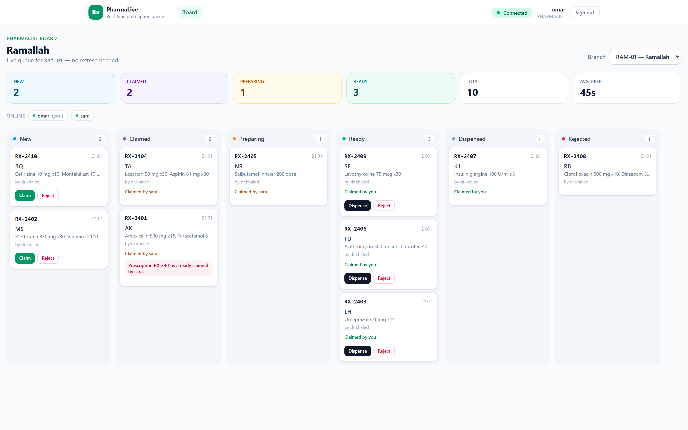
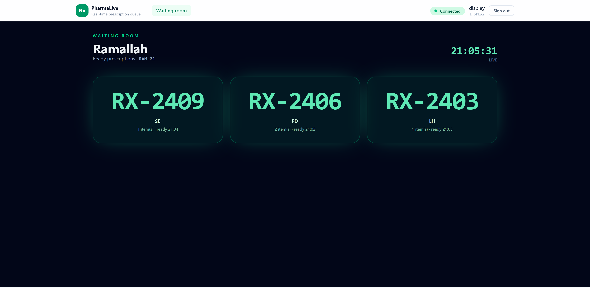

# PharmaLive — real-time multi-branch prescription queue

A live prescription queue for three pharmacy branches, built with **ASP.NET Core SignalR (.NET 10)**
and **Angular 22**. Doctors create prescriptions, pharmacists claim and move them through the
lifecycle, and the waiting-room screen shows the numbers that are ready — all without a refresh.

**Stack:** .NET 10 Web API · ASP.NET Core SignalR · Angular 22 (standalone, signals) · RxJS 7 ·
Tailwind CSS 4 · in-memory thread-safe store · xUnit + `WebApplicationFactory` + the .NET SignalR client.

---

## Screenshots

| Pharmacist board (live Kanban) | Claim race — the loser sees a readable error |
| --- | --- |
|  |  |

| Doctor workspace + private Ready toast | Waiting-room display |
| --- | --- |
|  |  |

| Invalid transition is reported next to the card | Dev login |
| --- | --- |
|  |  |

| New seed branches (Ramallah, Nablus, Hebron) |
| --- |
|  |
|  |


---

## Run it

**Prerequisites**

- .NET SDK **10** (built with 10.0.403)
- Node.js **22** and npm (built with 22.23.2 / 10.9.9)

**1. API** (terminal 1, from the repository root)

```bash
dotnet run --project server/PharmaLive.Api
# -> http://localhost:5000
```

**2. Angular app** (terminal 2)

```bash
cd client
npm install
npm start
# -> http://localhost:4200
```

The API URL lives in one place: [`client/src/app/core/config.ts`](client/src/app/core/config.ts).
If port 4200 is busy, run `npm start -- --port 4300`; CORS is open in development, so nothing else
changes.

**3. Sign in** — any user name with one of the three roles (the buttons at the bottom fill the form):

| User | Role | Lands on |
| --- | --- | --- |
| `dr.khaled` | Doctor | `/doctor` |
| `sara` | Pharmacist | `/pharmacist` |
| `omar` | Pharmacist | `/pharmacist` |
| `display` | Display | `/display` |

Branches: `RAM-01` Ramallah, `NAB-01` Nablus, `HEB-01` Hebron. The board and the doctor form
default to `RAM-01`.

**Tests**

```bash
dotnet test PharmaLive.slnx
# Passed! - Failed: 0, Passed: 4, Skipped: 0
```

> Use three windows (or three profiles/tabs): each tab keeps its own session in `sessionStorage`.
> Stop the API before `dotnet test` if it is running — the test build overwrites the same `bin/` output.

---

## What is implemented

### Level 1 — core

| Requirement | Where |
| --- | --- |
| `POST /api/auth/token` → JWT with `sub`, `name`, `role` | `Auth/TokenService.cs`, `Endpoints/AuthEndpoints.cs` |
| `POST /api/prescriptions` (Doctor only), 201, `createdBy` from the token | `Endpoints/PrescriptionEndpoints.cs` |
| `GET /api/prescriptions?branchId=…` for the initial load | same file |
| `PharmacyHub : Hub<IPharmacyClient>` at `/hubs/pharmacy`, `[Authorize]`, token from `?access_token=` | `Hubs/PharmacyHub.cs`, `Program.cs` |
| `JoinBranch` / `LeaveBranch` → group `branch:{id}`, unknown branch → readable `HubException` | `Hubs/PharmacyHub.cs`, `Hubs/PharmacyGroups.cs` |
| Create over HTTP pushes `PrescriptionCreated` via `IHubContext` | `Endpoints/PrescriptionEndpoints.cs` |
| Atomic `ClaimPrescription`; exactly one winner, the loser gets `… is already claimed by sara.` | `Services/PrescriptionStore.cs` |
| `UpdateStatus` validates transitions: `Cannot move RX-1024 from New to Ready.` | `Services/PrescriptionStore.cs` |
| Every change pushes `PrescriptionUpdated` | `Hubs/PharmacyHub.cs` |
| One root RxJS hub service: events as Observables, calls as Observables, state as a Signal | `core/signalr/hub-client.ts`, `core/signalr/pharmacy-hub.service.ts` |
| Pharmacist board: branch selector + one column per status, live moves | `pages/pharmacist/` |
| Doctor page: create form + live "my prescriptions" | `pages/doctor/` |
| Connection badge | `shared/connection-badge.ts` |
| Errors next to the action, never `alert()` | per-card errors in `pages/pharmacist/pharmacist.ts`, field errors in the forms |

### Level 2 — professional

| Requirement | Where |
| --- | --- |
| `withAutomaticReconnect`, first `start()` retried with back-off, groups rejoined after a reconnect | `core/signalr/hub-client.ts`, `core/signalr/pharmacy-hub.service.ts` |
| Actions disabled while disconnected | pharmacist buttons bound to `isConnected()` |
| Presence per branch, several tabs per user count once | `Services/PresenceTracker.cs`, chips on the board |
| Private `PrescriptionReady` via `Clients.User(...)` on all of the doctor's tabs, shown as a toast | `Hubs/PharmacyHub.cs`, `pages/doctor/doctor.ts`, `shared/toast-host.ts` |
| `/display/:branchId` shows Ready numbers live | `pages/display/display-screen.ts` |
| Hub filter logging hub/method/user/duration and hiding unexpected exceptions | `Hubs/Filters/HubLoggingFilter.cs` |
| `takeUntilDestroyed`, `share`, `scan`, `toSignal`; no nested subscribes | `core/live-queue.ts`, all pages |
| Reconnect resyncs the queue over HTTP (events missed while offline are not lost) | `core/live-queue.ts` |

**Lifecycle:** `New → Claimed → Preparing → Ready → Dispensed`, and any state before `Dispensed`
can go to `Rejected`. Only the pharmacist who claimed a prescription can move it.

---

## Level 3 — the two bonus items I built

### A. Streaming branch statistics

`StreamBranchStats(branchId)` returns `IAsyncEnumerable<BranchStatsDto>`: one snapshot immediately,
then one every 2 seconds (count per status, total, average claim→ready time).

- Server: [`Hubs/PharmacyHub.cs`](server/PharmaLive.Api/Hubs/PharmacyHub.cs) uses `PeriodicTimer`
  and `[EnumeratorCancellation] CancellationToken`.
- Client: [`core/signalr/hub-client.ts`](client/src/app/core/signalr/hub-client.ts) wraps
  `connection.stream()` in an Observable and **disposes the subscription on unsubscribe**, which
  cancels the server token — the loop stops when the pharmacist leaves the page or changes branch.
- The board restarts the stream after a reconnect and when the branch changes
  ([`pages/pharmacist/pharmacist.ts`](client/src/app/pages/pharmacist/pharmacist.ts)).

### B. Integration test proving the claim race

[`server/PharmaLive.Api.Tests/PharmacyHubTests.cs`](server/PharmaLive.Api.Tests/PharmacyHubTests.cs)
uses `WebApplicationFactory<Program>` and the real **.NET SignalR client**:

- two pharmacist connections,
- both `ClaimPrescription` invocations are started **before either is awaited** (`Task.WhenAll`),
  so it is a real race,
- asserts exactly one success, one `HubException`, and that the loser's message contains the
  prescription number, "already claimed by" and the winner's name.

The suite also proves branch isolation (an NAB-01 subscriber never receives a RAM-01 event), the
readable invalid-transition error, and the unknown-branch error — 4 tests, all green.

---

## Answers to the README questions

### 1. Why `?access_token=` instead of an `Authorization` header, and how is the risk reduced?

The browser's `WebSocket` and `EventSource` APIs cannot set custom headers — only a URL and
subprotocols. SignalR therefore exposes `accessTokenFactory`, and the JS client appends the token to
the negotiate/connect URL. On the server I read it **only for `/hubs` paths**
(`Program.cs`, `JwtBearerEvents.OnMessageReceived`); REST calls use the normal `Authorization`
header (`core/auth.service.ts` interceptor).

The risk is that URLs are copied into places headers are not: reverse-proxy/access logs, APM traces,
browser history, `Referer` headers, crash dumps, and screenshots. Mitigations used or recommended:

- scope query-token reading to `/hubs` only, so a REST endpoint can never be authenticated by URL;
- serve the app over TLS (`wss://`) in production; the URL is encrypted in transit;
- keep tokens short-lived (the dev issuer uses 8 h; a real IdP would issue minutes-long access tokens
  and refresh them) and keep them in `sessionStorage`, not `localStorage`;
- never log query strings (the hub filter logs method, user and duration only);
- for same-site deployments, cookie authentication or a one-time negotiate token avoids the URL
  entirely. SignalR also supports `skipNegotiation` only for WebSockets, which does not remove the
  query string.

### 2. Why rejoin groups after a reconnect? When does stateful reconnect help?

SignalR groups are keyed by **connection id** on the server:
`Groups.AddToGroupAsync(Context.ConnectionId, "branch:RAM-01")`. A reconnect that produces a new
connection id creates a connection with no groups, so branch broadcasts stop arriving. The client
therefore keeps the set of joined branches and, on `reconnected$`, invokes `JoinBranch` again
(`PharmacyHubService.rejoinAll`). It also refetches the queue over HTTP, because events emitted while
the socket was down are gone — rejoin fixes the future, not the gap.

**Stateful reconnect** (`AllowStatefulReconnects` on the server + `withStatefulReconnect()` in the
client) lets a short interruption resume the *same* connection: the server keeps it (and its group
membership) alive briefly and buffers outgoing messages, so within that window rejoin is unnecessary.
It does **not** help when:

- the server process restarted or crashed (groups and the buffer are in memory);
- the client was away longer than the server's timeout, or the buffer overflowed — the resume is
  rejected and a new connection is created;
- the client called `stop()`/`start()` (logout/login), which always creates a new connection;
- the app is scaled out and the reconnect lands on another server without a backplane.

So the defensive path must stay. This repo uses both: stateful reconnect for fast blips, and
rejoin + HTTP resync for everything else. I tested it by stopping the API for ~10 s: the badge went
`Reconnecting` → `Connected`, presence came back, the stats stream restarted, and the board
re-synced to the (fresh, in-memory) store.

### 3. `invoke` vs `send` — which is used where?

`invoke` sends a message **and waits for the server's response**; it resolves with the method's return
value and rejects with the server's `HubException`. `send` is fire-and-forget: it resolves when the
message is queued, returns nothing and cannot report a server-side failure.

Used in this app:

| Call | API | Why |
| --- | --- | --- |
| `JoinBranch` / `LeaveBranch` | `invoke` | the board must not show a branch before the server accepted the group change; an unknown branch is an error I show |
| `ClaimPrescription` | `invoke` | returns the updated DTO and the race loser needs the exact `HubException` text |
| `UpdateStatus` | `invoke` | same: invalid transitions must be shown next to the card |
| `StreamBranchStats` | `stream` | server-to-client stream, not a call |
| (future) "sara is viewing RX-1024" typing signal | `send` | losing one signal is harmless and waiting would add latency |

All three are wrapped as cold Observables in `core/signalr/hub-client.ts`, so a component subscribes
and `takeUntilDestroyed` cleans up.

### 4. Why can't hub state live in a field of the hub class?

Hubs are **transient**: `IHubActivator` creates a new hub instance for every invocation and disposes
it afterwards. Invocations of the same connection may even run concurrently. A field therefore

- does not survive to the next call (it is a fresh object),
- is not shared between users or connections,
- is not safe to mutate concurrently,
- and keying by `Context.ConnectionId` would break on reconnect anyway.

Everything stateful lives in singleton services injected into the hub — `PrescriptionStore`
(one lock around every read/write) and `PresenceTracker` (connections per user per branch) — or would
live in a database/Redis. A `static` field would be shared, but it is still process-local and needs
explicit synchronization.

### 5. The API runs on three servers tomorrow — what breaks, and how do I fix it?

1. **Prescription store** (`Services/PrescriptionStore.cs`) — each process has its own dictionary, so
   a prescription created on node 1 is invisible on node 2, and two nodes can both win a claim.
   *Fix:* EF Core/SQL (or Redis) with the claim as one atomic statement, e.g.
   `UPDATE Prescriptions SET Status='Claimed', ClaimedBy=@u WHERE Id=@id AND ClaimedBy IS NULL`,
   and check the affected-row count.
2. **SignalR groups** — `Clients.Group(...)` only reaches connections on the same node.
   *Fix:* a Redis backplane or Azure SignalR Service.
3. **Private `Clients.User(...)` messages** — the user→connection map is per node.
   *Fix:* the same backplane; keep `IUserIdProvider` consistent (it uses `sub`).
4. **Presence** (`Services/PresenceTracker.cs`) — in-memory, so each node reports a different list.
   *Fix:* Redis sets keyed by branch with per-connection entries and heartbeats/TTL; recompute on
   disconnect.
5. **Stats stream** — computed from the local store, so numbers would differ per node. *Fix:* compute
   from the shared store (or cache a snapshot in Redis); the per-connection 2 s timer is fine.
6. **Stateful reconnect** — the paused connection and its buffer live on one node, so a reconnect to
   another node cannot resume. *Fix:* sticky sessions at the load balancer, and keep the
   rejoin + HTTP resync as the fallback (already implemented).
7. **Negotiate/WebSockets** — without a backplane the handshake needs affinity, otherwise the
   negotiate response and the WebSocket request hit different nodes. *Fix:* sticky sessions (ARR,
   nginx `ip_hash`, YARP) or skip negotiation with WebSockets only.
8. **JWT** — the signing key, issuer and audience must be identical on every node, or a token issued
   by one is rejected by another. *Fix:* a shared secret from a secret manager (and rotate it with
   overlapping keys). The dev `/api/auth/token` endpoint also has to become a real IdP.
9. **`NextNumber()`** — scans the local dictionary and would hand out duplicates across nodes.
   *Fix:* a database sequence (or a Redis `INCR`).
10. **CORS** — the dev policy accepts any origin; a real deployment needs the explicit list of app
    origins (and `AllowCredentials` stays required for SignalR).
11. **Observability** — add the instance id to logs/metrics so "which node handled it?" is answerable;
    the current hub filter logs user and duration but not the instance.

---

## Project layout

```
server/
  PharmaLive.Api/
    Auth/            dev JWT issuer + user-id provider (sub)
    Contracts/       DTOs, statuses, validation rules
    Endpoints/       auth, branches, prescriptions (REST)
    Hubs/            PharmacyHub, IPharmacyClient, groups, logging filter
    Services/        PrescriptionStore (locked), PresenceTracker, BranchCatalog
  PharmaLive.Api.Tests/  4 integration tests (WebApplicationFactory + SignalR client)
client/src/app/
  core/              config, models, auth, HTTP service, live-queue helpers, toast
  core/signalr/      reusable hub client + PharmacyHubService (the only SignalR entry point)
  shared/            connection badge, toast host
  pages/             login, pharmacist board, doctor, display picker + screen
docs/screenshots/    images used above
```

## Notes and trade-offs

- The store is **in-memory**: restarting the API clears all prescriptions (and resets numbering).
  That is deliberate for the exercise; question 5 covers the production path.
- CORS uses `SetIsOriginAllowed(_ => true)` **for development only** because the Angular dev server
  runs on a different port.
- `/api/auth/token` is a **dev** login: it issues a token for any name/role. In production the token
  would come from an identity provider; the hub and REST authorization code stays the same.
- Errors are always specific to the item: `"Prescription RX-1024 is already claimed by sara."`,
  `"Cannot move RX-1024 from New to Ready."`, `"Branch 'XYZ' does not exist. Known branches: …"`,
  `"Prescription number 'RX-1024' already exists."`, `"Item 2 is empty. Enter a medicine name."`.
- No policy-based authorization: `[Authorize]` plus roles only.
